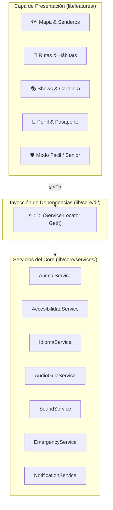
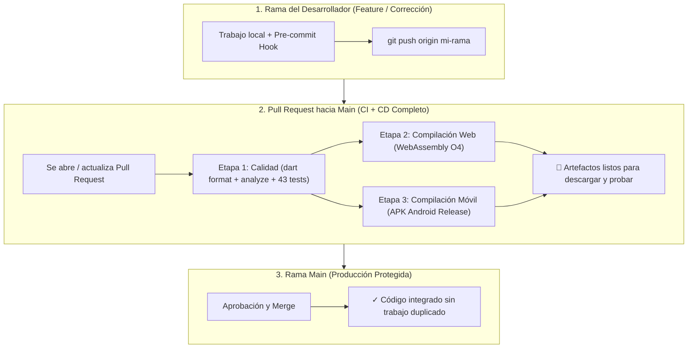

# 🐾 Parque de las Leyendas · Safari Interactivo (Frontend Móvil & Web)

<p align="center">
  
</p>

<p align="center">
  <strong>Aplicación móvil y web interactiva de exploración, educación biológica, geolocalización, accesibilidad universal y navegación inteligente para el Parque de las Leyendas.</strong>
</p>

<p align="center">
  
  
  
  
  
  
</p>

---

## 📖 ¿De qué trata este proyecto?

**Parque de las Leyendas · Safari Interactivo** es un sistema multiplataforma (**Android, iOS y Web**) desarrollado en **Flutter** diseñado para transformar por completo la experiencia de visita a un parque zoológico y centro de conservación. 

Integra navegación inteligente basada en grafos topológicos, cálculo de rutas mínimas asistidas (*pathfinding*), fichas biológicas interactivas adaptadas al hábitat natural, audioguías Text-To-Speech multilingües, pasaporte digital gamificado y un motor de **accesibilidad universal certificada con 100/100 en Google Lighthouse**.

---

## 💡 Factores de Innovación y Propuesta de Valor (Para Reclutadores & Auditoría)

| Área de Innovación | Proyecto Móvil Convencional | Safari Interactivo (Este Proyecto) | Valor Técnico y de Negocio |
| :--- | :--- | :--- | :--- |
| 🌐 **Inclusión Cultural Andina** | Solo Español / Inglés básico | **4 Idiomas completos:** Español, Inglés, Quechua (`qu`) y Aimara (`ay`) con diccionarios y audios TTS. | Preservación del patrimonio lingüístico y accesibilidad real para comunidades nativas. |
| 🧩 **Diseño Neurodivergente (TEA)** | No contemplado | **Zonas de Calma / Silencio** georreferenciadas con alertas de sobrecarga acústica. | Cumplimiento de accesibilidad cognitiva y diseño empático centrado en el usuario. |
| ♿ **Accesibilidad Web Certificada** | Sin auditar o &lt; 60% | **Puntaje Perfecto de 100/100 en Google Lighthouse** (WCAG 2.2 AA). | Ratios de contraste ≥ 4.5:1, etiquetas semánticas, filtros de daltonismo y escala dinámica de fuentes. |
| 🏛️ **Arquitectura de Software** | Código monolítico o acoplado | **Feature-First + Inyección de Dependencias con `GetIt` (`sl<T>`)**. | Modularidad desacoplada, alta cohesión y testabilidad con *Mocks* sin deuda técnica. |
| ⚡ **Rendimiento Web Extremo** | JS pesado con carga &gt; 5s | **WebAssembly (`dart2wasm` + `Skwasm`) + Skeleton Screen nativo (&lt; 2 KB)**. | LCP récord de **0.4 segundos**, CLS de **0** y carga binaria multihilo instantánea. |
| 🛡️ **DevOps y Calidad Continua** | Pruebas manuales sin pipeline | **Pipeline GitHub Actions inteligente** (CI en PR / CD en Main) + Git Pre-commit Hooks. | Cero regresiones, 43 pruebas automatizadas y compilación automática de APKs Release. |

---

## 🛠️ Stack Tecnológico Completo

* **Framework Principal:** Flutter 3.47+ & Dart 3.13+ (Sound Null Safety).
* **Inyección de Dependencias:** `GetIt` (Service Locator Pattern con resolución O(1)).
* **Compilación Web:** WebAssembly (`dart2wasm`), Skwasm Renderer, aislamiento COOP / COEP y servidor Gzip.
* **Multimedia y Voz:** `flutter_tts` (Text-To-Speech multilingüe) y `speech_to_text` (Búsqueda por voz).
* **Navegación & Gráficos:** `vector_math` (transformaciones matriciales 2D/3D), `path_drawing` y `CustomPainter`.
* **Automatización y CI/CD:** GitHub Actions (Pipelines optimizados), Git Pre-commit Hooks y cobertura `lcov.info`.
* **Testing:** 43 pruebas automatizadas (Unit, Widget y Flow Testing).
* **Tipografía y UI:** Google Fonts *Urbanist* y sistema de diseño biofílico Safari.

---

## 🌟 Pilares y Características Principales

### ♿ 1. Accesibilidad Universal e Inclusión (WCAG 2.2 Nivel AA)
* **4 Idiomas Nativos Integrados:** Soporte reactivo completo para **Español, English, Quechua (`qu`) y Aimara (`ay`)** en todas las pantallas y audioguías.
* **Zonas de Calma / Silencio:** Señalización y guiado georreferenciado hacia espacios de regulación sensorial para visitantes neurodivergentes o con Trastorno del Espectro Autista (TEA).
* **Modo Daltonismo:** Filtros cromáticos tácticos y símbolos geométricos adaptados para *Protanopia, Deuteranopia y Tritanopia*.
* **Escala Tipográfica Dinámica:** Selector de tamaño de fuente en tiempo real (*Normal 1.0x, Medio 1.15x, Grande 1.30x*).
* **Modo Fácil / Senior:** Interfaz de alto contraste simplificada con botones táctiles de 48×48 px, botón SOS de emergencia directo y búsqueda por voz.

### 🗺️ 2. Navegación Asistida y Mapa Topológico
* Mapa vectorial e interactivo con paneo y zoom fluido mediante transformaciones matriciales.
* **Cálculo de Rutas en Tiempo Real:** Algoritmo de senderos que traza el camino más corto hacia el animal seleccionado con animaciones de trazo dinámico (`CustomPainter`).
* **Filtros de Servicios Esenciales:** Ubicación inmediata de baños higiénicos, tópicos de primeros auxilios, zonas de descanso y accesos.

### 🦁 3. Fichas de Campo y Pasaporte Gamificado
* Fichas biológicas con diseño biofílico personalizado según el hábitat: *Costa, Sierra, Selva, Sabana Africana y Zona Internacional*.
* **Pasaporte de Visitas:** Animación elástica de impacto que estampa un sello oficial inclinado al visitar cada especie, con cálculo de porcentaje de expedición.
* **Audioguías Text-To-Speech (TTS):** Síntesis de voz pausada y natural para cada animal y espectáculo.

### 🚀 4. Rendimiento Web de Última Generación
* **WebAssembly Puro (`dart2wasm` + `Skwasm`):** Compilación nativa en código binario con aislamiento de origen cruzado (COOP / COEP) que erradica el tiempo de parseo de JavaScript.
* **Skeleton Screen Interactivo:** Pantalla de precarga semántica con efecto *shimmer* en HTML/CSS puro (< 2 KB) que logra un **LCP de 0.4s** y **CLS de 0**.

---

## 🏛️ Arquitectura del Software e Inyección de Dependencias

El código sigue una arquitectura modular **Feature-First** con inversión de control mediante **`GetIt` (Service Locator)**:



* Para consultar la especificación exhaustiva de métodos, tipos de retorno y reglas de ciclo de vida (`dispose`), consulta la [📘 Documentación de API Interna](docs/API_INTERNA.md).

---

## 🛡️ DevOps: CI/CD y Calidad de Código (Estrategia PR-First)

El repositorio implementa una estricta política de **Protección de Rama y Gobernanza de Código**:
* 🚫 **`main` Protegida:** Está terminantemente prohibido hacer `git push origin main` directo. Todo cambio debe originarse en una rama secundaria y pasar por un **Pull Request**.
* ⚡ **CI/CD Centralizado en Pull Request:** La auditoría completa (Análisis, 43 Pruebas, Compilación Web Wasm y Compilación del APK Android) se ejecuta **exclusivamente en el Pull Request**. De este modo, el revisor puede probar el APK y la Web antes de aprobar el merge, dejando la rama `main` limpia y libre de sobrecarga.



### 1. Pre-commit Hook Local
Antes de cada `git commit`, el hook local ([.git/hooks/pre-commit](.git/hooks/pre-commit)):
1. Formatea automáticamente el código con `dart format`.
2. Ejecuta `flutter analyze --no-fatal-infos`.
3. Corre las **43 pruebas unitarias**. Si algo falla, el commit se cancela automáticamente.
*(Instalador para Windows disponible en `scripts/instalar_git_hooks.bat`)*.

### 2. Integración Continua (CI) en Pull Requests
* Evalúa formato, salud estática y suite de pruebas en menos de 1 minuto sin compilar instaladores innecesarios.

### 3. Entrega Continua (CD) en Main
* Al unirse el PR a la rama principal, empaqueta los instaladores listos para el usuario:
  * 📁 `flutter-web-bundle`: Aplicación Web en WebAssembly optimizada.
  * 📁 `android-release-apks`: Instaladores APK para dispositivos Android reales.

---

## 📁 Estructura del Directorio

```text
zoologico_front/
├── .github/workflows/                       # Pipeline de Integración y Despliegue Continuo (CI/CD)
│   └── flutter_ci_cd.yml
├── docs/                                    # Documentación técnica corporativa
│   └── API_INTERNA.md
├── scripts/                                 # Utilidades y scripts de automatización
│   └── instalar_git_hooks.bat
├── lib/
│   ├── main.dart                            # Inicialización e inyección de dependencias
│   ├── core/                                # Componentes transversales del sistema
│   │   ├── data/                            # Marcadores GPS, catálogo biológico y nodos
│   │   ├── di/                              # InjectionContainer (Service Locator con GetIt)
│   │   ├── models/                          # Entidades (MarcadorMapa, DatosAnimal)
│   │   ├── services/                        # Servicios de negocio (Animal, Idioma, Accesibilidad, etc.)
│   │   ├── theme/                           # Colores biofílicos e institucionales
│   │   └── widgets/                         # Modales y widgets globales
│   └── features/                            # Módulos encapsulados por dominio
│       ├── carga_pagina/                    # Splash y precarga
│       ├── mapa/                            # Mapa interactivo, rutas SVG y controles
│       ├── modo_facil/                      # Interfaz inclusiva para adultos mayores y accesibilidad
│       ├── pantalla_principal/              # Menú home, búsquedas y accesos rápidos
│       ├── perfil/                          # Pasaporte, insignias e idiomas
│       ├── rutas/                           # Exploración guiada por hábitat
│       └── shows/                           # Cartelera, horarios y espectáculos
├── test/                                    # Suite de 43 pruebas automatizadas
│   ├── accesibilidad_inclusion_test.dart
│   ├── idioma_y_footer_modo_facil_test.dart
│   ├── injection_container_test.dart
│   └── nuevas_funcionalidades_test.dart
└── web/                                     # Maquetación WebAssembly con Skeleton Shimmer
    ├── index.html
    └── manifest.json
```

---

## 🧪 Pruebas Automatizadas y Calidad

Para ejecutar la suite completa de pruebas unitarias y de widgets:
```bash
flutter test
```

Para verificar la cobertura de código:
```bash
flutter test --coverage
```

Para correr el análisis estático estandarizado:
```bash
flutter analyze
```

---

## 💻 Instalación y Ejecución Local

### Requisitos previos
* [Flutter SDK](https://docs.flutter.dev/get-started/install) (versión 3.22+ recomendada).
* [Dart SDK](https://dart.dev/get-dart) (versión 3.13+).
* Java JDK 17 (para compilación Android).

### Pasos
1. **Clonar el repositorio:**
   ```bash
   git clone https://github.com/Isabelopez02/safari-world.git
   cd safari-world
   ```

2. **Instalar dependencias:**
   ```bash
   flutter pub get
   ```

3. **Ejecutar en Móvil (Emulador o Celular conectado):**
   ```bash
   flutter run
   ```

4. **Compilar y Ejecutar en Web con WebAssembly:**
   ```bash
   flutter build web --wasm --release -O4 --no-source-maps
   python gzip_server.py
   ```
   Abre tu navegador en `http://localhost:8080` para disfrutar de la experiencia ultra-fluida.

---

## 📄 Licencia y Créditos

Este proyecto fue desarrollado con fines académicos y de divulgación científica para el aprendizaje de arquitectura limpia en Flutter, estándares internacionales de accesibilidad web (WCAG 2.2 AA) y diseño de experiencias inclusivas orientadas a la conservación de la fauna silvestre en el Parque de las Leyendas.
