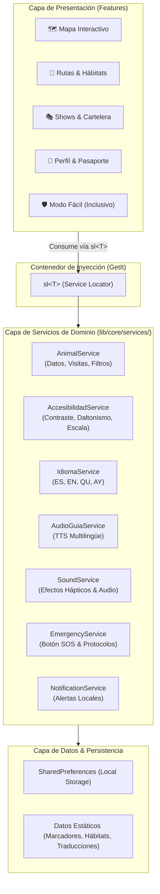

# 📘 Documentación Técnica de API Interna y Arquitectura
**Proyecto:** Parque de las Leyendas · Safari Interactivo (Frontend Móvil & Web)  
**Versión:** 1.0.0+1  
**Estándar de Calidad:** Enterprise / WCAG 2.2 AA / Clean Architecture (Feature-First)  

---

## 🏛️ 1. Arquitectura General del Sistema

El proyecto implementa una arquitectura modular **Feature-First** con inversión de control y desacoplamiento mediante **Service Locator (Inyección de Dependencias con `GetIt`)**.



---

## 💉 2. Inyección de Dependencias (`sl<T>`)

Todas las dependencias esenciales se configuran en `lib/core/di/injection_container.dart` bajo el ciclo de vida **`registerLazySingleton`** (se instancian únicamente al ser requeridas y persisten en memoria durante toda la sesión).

### 📖 Cómo consumir un servicio en cualquier Widget o Controlador:
```dart
import 'package:zoologico_front/core/di/injection_container.dart';
import 'package:zoologico_front/core/services/animal_service.dart';

// Resolución O(1) de la instancia centralizada
final animalService = sl<AnimalService>();
```

### 🧪 Cómo Mockear un servicio durante Pruebas Automatizadas (Testing / QA):
```dart
// En el setUp() del archivo de test:
sl.unregister<AnimalService>();
sl.registerSingleton<AnimalService>(MockAnimalService());
```

---

## 📦 3. Catálogo de Servicios del Core

### 🦁 3.1. `AnimalService`
**Ubicación:** `lib/core/services/animal_service.dart`  
**Responsabilidad:** Consulta de animales, trazado de paraderos, normalización de búsquedas y gestión reactiva de visitas persistidas.  
**Extiende:** `ChangeNotifier` (Reactivo).

| Método / Propiedad | Tipo de Retorno | Descripción |
| :--- | :--- | :--- |
| `obtenerAnimalPorId(String id)` | `DatosAnimal?` | Retorna la ficha técnica y biológica del animal consultado. |
| `obtenerTodosLosPines()` | `List<MarcadorMapa>` | Obtiene todos los marcadores georreferenciados del zoológico. |
| `toggleVisitado(String animalId)` | `Future<void>` | Marca o desmarca un animal en el Pasaporte, persiste el cambio en `SharedPreferences` y notifica a los listeners. |
| `esVisitado(String animalId)` | `bool` | Consulta si el animal ya fue sellado/visitado. |
| `animalesPorHabitat(String habitat)` | `List<MarcadorMapa>` | Filtra los pines según la zona (*Costa, Sierra, Selva, Internacional*). |
| `totalVisitadosPorHabitat(String habitat)` | `int` | Retorna la cantidad de animales visitados en una zona específica. |
| `normalizarTexto(String texto)` | `String` *(Static)* | Elimina tildes, mayúsculas y caracteres diacríticos para búsqueda tolerante a faltas ortográficas. |

---

### ♿ 3.2. `AccesibilidadService`
**Ubicación:** `lib/core/services/accesibilidad_service.dart`  
**Responsabilidad:** Control de preferencias visuales y cognitivas según directrices WCAG 2.2 AA.  
**Extiende:** `ChangeNotifier` (Reactivo).

| Método / Propiedad | Tipo de Retorno | Descripción |
| :--- | :--- | :--- |
| `altoContraste` | `bool` | Estado activo/inactivo del modo de máximo contraste cromático. |
| `tipoDaltonismo` | `TipoDaltonismo` | Filtro seleccionado (`ninguno`, `protanopia`, `deuteranopia`, `tritanopia`). |
| `multiplicadorEscalaTexto` | `double` | Factor de escala de fuentes (`1.0x` Normal, `1.15x` Medio, `1.30x` Grande). |
| `zonasDeCalma` | `List<ZonaCalma>` | Lista georreferenciada de espacios de silencio para visitantes con TEA o sensibilidad auditiva. |
| `toggleAltoContraste()` | `void` | Invierte el estado de alto contraste y actualiza la UI global. |
| `cambiarModoDaltonismo(TipoDaltonismo modo)` | `void` | Aplica una matriz de transformación de color a los marcadores del mapa. |
| `cambiarEscalaTexto(double factor)` | `void` | Modifica el tamaño de letra en toda la aplicación de forma dinámica. |

---

### 🌐 3.3. `IdiomaService`
**Ubicación:** `lib/core/services/idioma_service.dart`  
**Responsabilidad:** Motor de internacionalización y localización en 4 idiomas nativos.  
**Extiende:** `ChangeNotifier` (Reactivo).

| Método / Propiedad | Tipo de Retorno | Descripción |
| :--- | :--- | :--- |
| `idiomaActual` | `IdiomaApp` | Código del idioma en curso (`es`, `en`, `qu` [Quechua], `ay` [Aimara]). |
| `cambiarIdioma(IdiomaApp nuevo)` | `Future<void>` | Cambia el diccionario activo, guarda la preferencia en disco y refresca los widgets suscritos. |
| `traducir(String clave)` | `String` | Busca la clave en el diccionario activo; si no existe, recurre al español por defecto (*fallback*). |
| `extension String.tr` | `String` | Azúcar sintáctico para traducir cualquier cadena: `'buscar_animales'.tr`. |

---

### 🎙️ 3.4. `AudioGuiaService`
**Ubicación:** `lib/core/services/audioguia_service.dart`  
**Responsabilidad:** Narración auditiva mediante Text-To-Speech (TTS) nativo.  
**Extiende:** `ChangeNotifier` (Reactivo).

| Método / Propiedad | Tipo de Retorno | Descripción |
| :--- | :--- | :--- |
| `isPlaying` | `bool` | Indica si actualmente se está narrando una audioguía. |
| `currentText` | `String` | Texto que se está reproduciendo en la sesión. |
| `reproducir(String texto, {String lang})` | `Future<void>` | Inicia la síntesis de voz ajustando velocidad (0.48x) y tono natural (1.0). |
| `pausar()` / `detener()` | `Future<void>` | Pausa o frena inmediatamente la reproducción de voz. |

---

### 🔊 3.5. `SoundService`
**Ubicación:** `lib/core/services/sound_service.dart`  
**Responsabilidad:** Retroalimentación háptica y reproducción de efectos sonoros de la interfaz.

| Método | Tipo | Descripción |
| :--- | :--- | :--- |
| `playButtonTap()` | `Future<void>` | Reproduce sonido de clic sutil y vibración suave al pulsar botones. |
| `playSuccess()` | `Future<void>` | Efecto sonoro de recompensa al sellar un animal en el pasaporte. |
| `playRugidoLeon()` | `Future<void>` | Efecto sonoro temático para bienvenida o interacciones especiales. |

---

### 🚨 3.6. `EmergencyService`
**Ubicación:** `lib/core/services/emergency_service.dart`  
**Responsabilidad:** Asistencia inmediata y protocolos de seguridad del visitante.

| Método | Tipo | Descripción |
| :--- | :--- | :--- |
| `llamarCentralSeguridad()` | `Future<bool>` | Dispara el marcado telefónico nativo hacia el conmutador de emergencia del parque. |
| `solicitarAyudaMedica()` | `Future<bool>` | Activa el protocolo de asistencia médica inmediata. |
| `obtenerUbicacionActual()` | `UbicacionEmergencia` | Devuelve las coordenadas GPS o el sector más cercano para rescate. |

---

### 🔔 3.7. `NotificationService`
**Ubicación:** `lib/core/services/notification_service.dart`  
**Responsabilidad:** Gestión de notificaciones locales de recordatorio de shows y eventos.

| Método | Tipo | Descripción |
| :--- | :--- | :--- |
| `init()` | `Future<void>` | Configura los canales de notificación en Android (canal de alta prioridad) e iOS. |
| `mostrarNotificacionInmediata(...)` | `Future<void>` | Lanza una notificación emergente nativa al dispositivo. |
| `programarAvisoShow(...)` | `Future<void>` | Programa una alerta con 15 minutos de anticipación al inicio de un show. |

---

## 🛡️ 4. Guía de Concurrencia y Ciclos de Vida (Memory Safety)

1. **Liberación de Controladores (*Dispose Rule*):**
   * Todo `TextEditingController`, `AnimationController` o `ScrollController` debe destruirse invocando `.dispose()` en el método `dispose()` de su respectivo `StatefulWidget` o en el callback `.whenComplete()` de modales transitorios.
2. **Suscripciones Reactivas:**
   * Utilizar preferentemente `ListenableBuilder` o `ValueListenableBuilder` para evitar suscripciones manuales de `addListener` que requieran `removeListener`.
3. **Manejo de Errores Silenciosos:**
   * Todo método asíncrono hacia hardware (TTS, Audio, Sensores, Almacenamiento) debe estar encapsulado en bloques `try / catch` para evitar caídas imprevistas (*crashes*) si el dispositivo carece de permisos.
